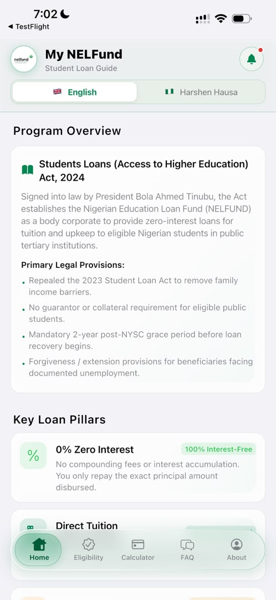
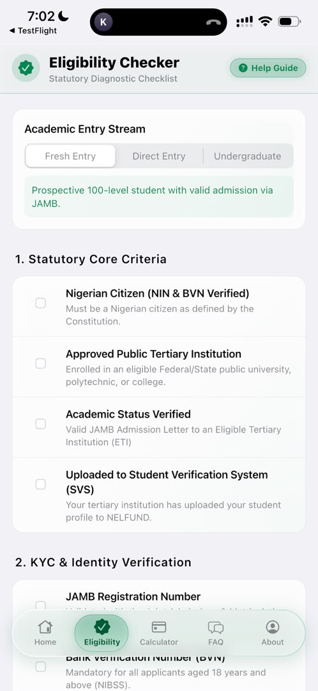
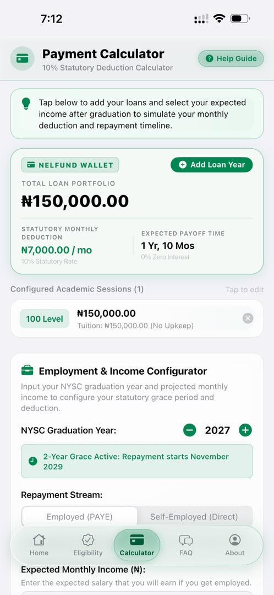
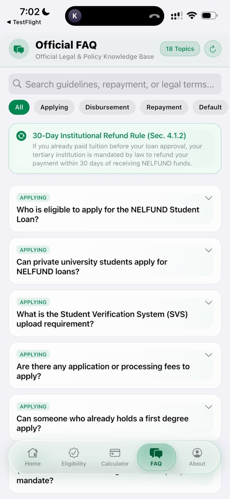
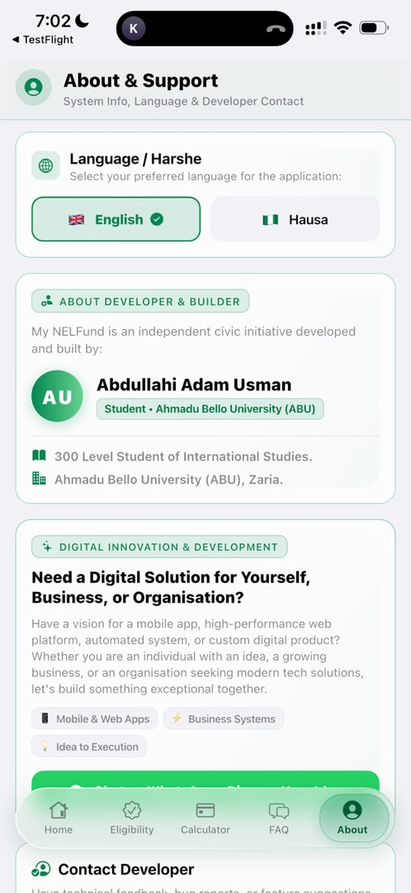

# My NELFund — Student Loan Guide (English & Hausa)

> **Disclaimer:** *My NELFund* is an **independent, unofficial civic utility** built to help Nigerian tertiary students understand the **Students Loans (Access to Higher Education) Act, 2024**. It is **not** affiliated with, endorsed by, or an official portal of the Nigerian Education Loan Fund (NELFUND). Official applications and account inquiries belong exclusively on [`nelf.gov.ng`](https://nelf.gov.ng).

[](https://play.google.com/store/apps/details?id=com.mynelfund.app)
[](https://apps.apple.com/ng/app/my-nelfund/id6809634284)
[](https://flutter.dev)
[](./LICENSE)

---

## Live Adoption & Production Telemetry

Measured via Firebase Analytics (`my-nelfund` production property, **Aug 20 – Nov 16, 2026** across iOS & Android):

| Metric | Verified Value |
| --- | ---: |
| **Total Installs (`first_open`)** | **5,636** |
| **30-Day Active Users (Peak MAU)** | **3,402** |
| **7-Day Active Users (Peak WAU)** | **1,191** |
| **Loan Repayment Calculations** | **10,492** |
| **Eligibility Audits Completed** | **5,643** |
| **Total Screen Views** | **61,673** |
| **Crash-Free Users (iOS `2.2.7` & Android `2.2.6`)** | **100%** |
| **Countries Reached** | **41** (`5,420` active users in Nigeria + diaspora) |

---

## Screenshots

| Home & Program Overview | Eligibility Checker | Repayment Calculator | Official FAQ | Bilingual & Support |
| :---: | :---: | :---: | :---: | :---: |
|  |  |  |  |  |

---

## Key Features

- **Bilingual English & Hausa (`AppLocale` / `AppTranslations`):** One-tap language switcher in the header and onboarding flow, paired with language-segmented FCM topic subscriptions (`lang_en`, `lang_ha`).
- **Statutory Eligibility Diagnostic:** Interactive checklist covering Fresh Entry, Direct Entry, and Undergraduate criteria (NIN/BVN, ETI/SVS upload status, and statutory disqualification rules).
- **10% Statutory Repayment Calculator:** Simulates Employed (PAYE) and Self-Employed (IBR) repayment timelines at 0% interest with the mandatory 2-year post-NYSC grace period, voluntary extra prepayments, and default escalation visibility.
- **Offline-Resilient Official FAQ & Timeline Tracker:** Bundles statutory policy FAQs locally with Cloud Firestore live sync, `connectivity_plus` auto-recovery, and an SLA turn-around evaluator.
- **Apple Cupertino / Frosted Glass UI:** Custom `AppleFrostedCard`, `LiquidGlassHeader`, and `LiquidGlassNavBar` components with automated widget, unit, and integration tests.

---

## Project Structure

```text
lib/
├── core/
│   ├── constants/       # Static statutory NELFUND data & SLAs
│   ├── localization/    # English & Hausa translation engine + LocaleProvider
│   ├── services/        # Analytics, FCM notifications, in-app review & update services
│   └── theme/           # NelfundColors, NelfundTypography, NelfundTheme
├── models/              # Eligibility, FAQ, Notification, Promo, Repayment, Timeline
├── providers/           # ChangeNotifier state management & local caching
├── views/               # Home, Eligibility, Calculator, FAQ, Timeline, Notifications, About
└── widgets/             # Cupertino frosted glass UI primitives
test/                    # 15 unit, widget, and integration test suites
```

---

## Getting Started

```bash
git clone https://github.com/Abdallahnangere/mynelfund-app.git
cd mynelfund-app
flutter pub get
flutter analyze
flutter test
flutter run
```

> **Firebase Note:** Client Firebase config (`lib/firebase_options.dart`, `android/app/google-services.json`, `ios/Runner/GoogleService-Info.plist`) is wired for the production read-only content feeds (`faqs`, `notifications`, `app_config`). To run against your own Firebase project, reconfigure with `flutterfire configure`.

---

## Author & License

Built by **Abdullahi Adam Usman** (Student, Ahmadu Bello University, Zaria).  
Released under the [MIT License](./LICENSE).
